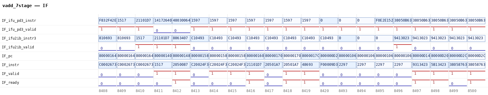
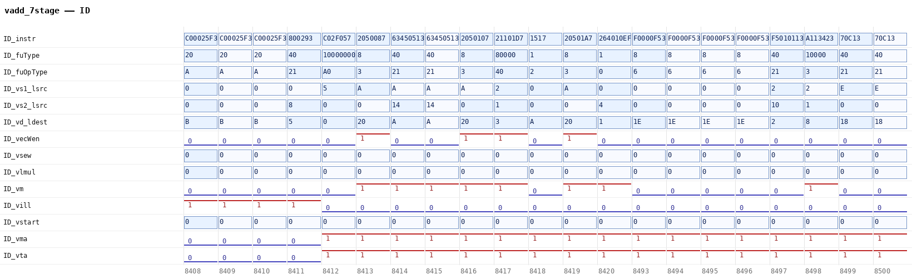
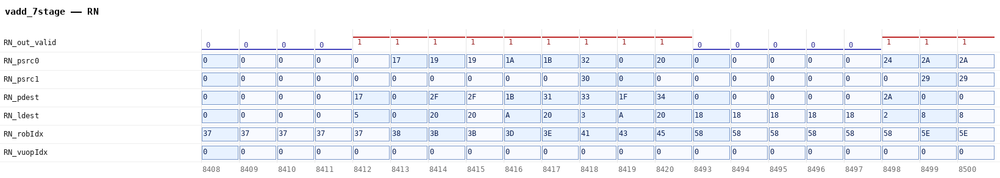
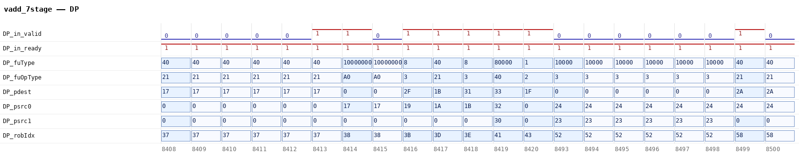
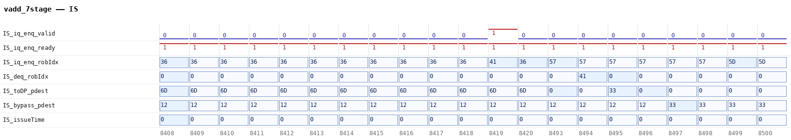
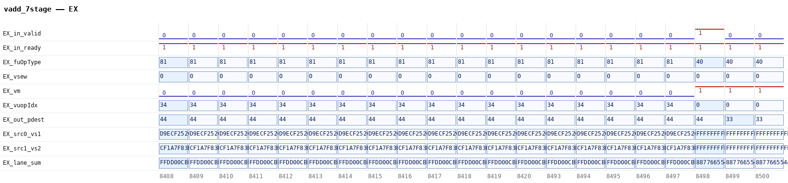
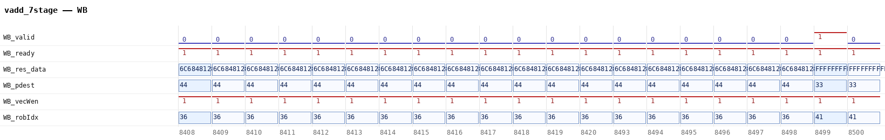
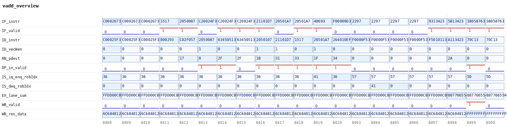

# 03 VADD 指令执行过程

一条普通的向量加法 `vadd.vv v3, v1, v2` 在香山昆明湖 V2 的 RTL 仿真里走完七个流水站，每一站都留下了实测信号与逐拍取值。同一份波形抽出的表是 68 列、109 拍，七站没有一站靠读代码推演。这一章说明这七站各自在图上显示什么、取值说明什么，因为判断 `vdot.vv` 该接在哪一站之前，先要认出这条共用通路的端口。

## 3.1 取证对象与方法

流水站的实际拍号由调度与阻塞决定。读 RTL 能知道指令经过哪些模块，不知道这一条指令在第几拍经过。取证对象因此是一次真实运行的波形，不是源码。

用例 `cases/vadd_wave.c` 只发一条 `vadd.vv`。它前面有两条 `vle8.v`，把 `01 02 03 04 05 06 07 08` 装进 v1、`10 20 30 40 50 60 70 80` 装进 v2；配置是 `vsetvli e8, m1, ta, ma`，`vl=8`。只发一条的用意，是让七站里每一步只对应一个 uop（微操作，指令在流水里的最小执行单位）。

波形来自一份带 trace 的 emu（用 Verilator 把 RTL 编成的软件仿真器）。运行日志的生效判定记作「`dump wave to %s` 字符串数=1」，同段记 `EMU_TRACE=1` 提示串数为 0。波形文件是 VCD（逐拍记录信号取值的文本），时间戳单位 1 ps，每拍（每个时钟周期）一个时间戳；本章窗口取 8408 到 8516，共 109 个采样拍。

定位靠指令字。VCD 里有 1,357,193 个变量、16,331 个层次，人工找不到目标。抽取脚本按 `0x021101D7` 在译码入口的 6 个槽里搜 `valid=1` 的那一次，得到锚点 8416；之后的站用物理目标号 `0x33` 与 ROB 项号 `0x41` 串起来（ROB 是乱序处理器里按程序顺序记录指令的表项）。

抽取结果是 `raw/vadd_stages.tsv`：68 列、109 个数据行，加表头 110 行。每一格是 VCD 在该拍的端口值，由 `scripts/61-extract-stages.sh` 调用 `vadd_stage_extract.py` 生成，不是人工填表。

本章共八张图。分站图七张，由 `wave_render.py` 从 61 列（含拍号列）、21 拍的精简表渲染；总览图一张，用 12 列、21 拍的表。21 拍是两段：8408 到 8420，8493 到 8500。被跳过的 8421 到 8492 共 72 拍，落在发射队列驻留期之内，不画是因为图会宽到看不清。

一句边界：这七站是整核流水，不是点积单元内部的两拍；后者见第 5 章。

## 3.2 七站分工

本章在写回之前取到五个站：取指、译码、重命名、派发、发射；加上执行与写回共七站。寄存器读没有单独成站：发射出队在 8494，8495 那一拍 `toDataPathAfterDelay` 的 valid 为 1 并带出 `pdest=0x33`，读寄存器的地址与读使能没有抽进这 68 列。退休（提交，指令离开 ROB、结果不再可撤销）的逐拍取值也没有抽进表，原因写在 3.5。

表 03-1 按执行顺序列七站。第三列是本章实际取到的端口，第四列是这一站算走完的条件。这些条件在表 03-2 的对应拍上都有取值：握手类的站看 valid 与 ready 同时为 1，发射看的是出队那一拍，译码看的是出口的 vecWen。

表 03-1　七站分工与关键信号

| 站 | 做什么 | 本章取到的信号 | 算走完的条件 |
|---|---|---|---|
| 取指 | IFU 取出指令字，经预译码写进 IBuffer | `preDecoder/io_out_instr_3`、`io_toIbuffer_bits_instrs_3`、`decode/io_in_2_{instr,valid,ready}` | 译码入口 valid 与 ready 同为 1 |
| 译码 | 查出功能单元类型、运算码、源与目的寄存器号、向量配置 | `decode/io_out_0_bits_{fuType,fuOpType,lsrc_0,lsrc_1,ldest}`、`decode/io_out_0_bits_vpu_{vsew,vlmul,vm}` | 出口 vecWen 为 1 |
| 重命名 | 逻辑寄存器号换成物理号，分配 ROB 项 | `rename/io_out_0_bits_{psrc_0,psrc_1,pdest,robIdx_value}` | 出口 valid 为 1 |
| 派发 | 把 uop 送进对应的发射队列 | `dispatch/io_fromRename_0_{valid,ready,pdest,robIdx_value}` | 入口 valid 与 ready 同为 1 |
| 发射 | 在队列里等到可以出队，出队后送 dataPath | `IssueQueueVfmaVialuFixVfalu/io_enq_0_*`、`deqBeforeDly_0_bits_common_robIdx_value`、`io_toDataPathAfterDelay_1_0_bits_common_pdest` | 出队并送出 `pdest` |
| 执行 | VIAluFix 的 64 位整数加法器逐 lane 相加 | `io_in_bits_data_src_0`、`io_in_bits_data_src_1`、`vIntFixpAlus_0/vIntAdder64b/io_vd` | 入口 valid 与 ready 同为 1 |
| 写回 | 结果连同目的物理号、写使能送回后端 | `io_out_bits_res_data`、`io_out_bits_ctrl_{pdest,vecWen,robIdx_value}` | 出口 valid 与 ready 同为 1 |

译码入口 8416、译码出口 8417、重命名 8418、派发 8419，四个拍号连着走。发射一站长得多：8419 入队、8494 出队，驻留 75 拍。执行与写回各一拍，分别在 8498 与 8499。这张表说明这 75 拍不在执行级；它不能说明驻留为什么长，因为 68 列里没有操作数就绪或唤醒信号。

## 3.3 一条指令的逐拍轨迹

表 03-2 把同一条指令在七站的出现拍号排在一起，拍号取自 `vadd_stages.tsv` 的 `time` 列。

表 03-2　一条 vadd 的逐拍轨迹

| 站 | 拍号 | 该拍读到的值 |
|---|---|---|
| 取指 | 8410 / 8411 / 8416 | `ifu_pd3_instr=0x021101D7`；`ifu2ib_instr3` 同值；`pc=0x80000160`、`instr=0x021101D7`、`valid=ready=1` |
| 译码 | 8417 | `fuType=0x000080000`、`fuOpType=0x040`、`lsrc_0/1=0x02/0x01`、`ldest=0x03`、`vsew=0`、`vlmul=0`、`vm=1` |
| 重命名 | 8418 | `psrc_0=0x32`、`psrc_1=0x30`、`pdest=0x33`、`robIdx=0x41` |
| 派发 | 8419 | `in_valid=in_ready=1`，`pdest=0x33`、`robIdx=0x41` |
| 发射 | 8419 入队；8494 出队；8495 送 dataPath；8497 进旁路网络 | `iq_enq_robIdx=0x41`；`deq_robIdx=0x41`；`toDP_pdest=0x33`；`bypass_pdest=0x33` |
| 执行 | 8498 | `in_valid=1`、`fuOpType=0x040`、`lane_sum=0x8877665544332211` |
| 写回 | 8499 | `valid=1`、`res_data[63:0]=0x8877665544332211`、`pdest=0x33`、`vecWen=1`、`robIdx=0x41` |

指令字 `0x021101D7` 在 8410、8411、8416 三处出现，8417 从译码出口带出。此后不再靠指令字识别，改用两个编号：物理目标号 `0x33` 在 8418、8419、8495、8497、8499 出现，ROB 项号 `0x41` 在 8418、8419、8494、8497、8499 出现。两个编号在重命名、派发、发射、写回四站同值，这是同一条 uop 的凭据。

译码那一拍还能读出这条指令的身份：`lsrc_0=0x02` 是 vs1（即 v2），`lsrc_1=0x01` 是 vs2（即 v1），`ldest=0x03` 是 vd（即 v3）。`vsew=0`、`vlmul=0`、`vm=1` 分别对应 SEW=8、LMUL=1、不屏蔽。

## 3.4 八张波形图

图 03-1 到图 03-7 一站一张，图 03-8 是七站总览。分站图每张 21 拍，最多 14 行信号；横轴是拍号，单比特信号画高低电平，总线画成带十六进制值的方格。

图 03-1 的取指段有三个端口依次出现同一个指令字。8410 行 `ifu_pd3_instr` 从 `1517` 跳成 `21101D7`，下一拍 `ifu2ib_instr3` 同值，8416 行 `instr` 同值且 `valid` 与 `ready` 同为 1。三处连线说明指令先到预译码出口、再进 IBuffer（指令缓冲）、然后交给译码。

图 03-1　取指级：同一指令字在三个端口依次出现（横轴拍号，21 拍）

图 03-2 的看点是译码出口那一拍的类型跳变。8417 行 `fuType` 从 `8` 跳到 `80000`，`fuOpType` 跳到 `40`，同一行 `vsew`、`vlmul`、`vm` 是 `0`、`0`、`1`。功能单元在这一拍定为向量定点 ALU，后面的派发与执行都按这个类型走。

图 03-2　译码级：类型与向量配置在 8417 定格（横轴拍号，21 拍）

图 03-3 的看点是逻辑号换物理号。8418 行 `pdest` 跳成 `33`，`psrc_0`、`psrc_1` 是 `32`、`30`，`robIdx` 是 `41`。从这一拍起，这条指令由 `pdest` 与 `robIdx` 两个编号标识，不再靠指令字。

图 03-3　重命名级：物理号 0x33 与 ROB 项 0x41 在 8418 出现（横轴拍号，21 拍）

图 03-4 的看点是派发没有改指令。8419 行 `in_valid` 与 `in_ready` 同为 1；`pdest`、`robIdx` 与重命名出口相同，`fuType`、`fuOpType` 与译码出口相同。派发只是换了一个排队的地方。

图 03-4　派发级：字段与上一站逐项相同（横轴拍号，21 拍）

图 03-5 的看点是两段分开的活跃期。8419 行 `iq_enq_valid` 拉高、`iq_enq_robIdx` 是 `41`；8494 行 `deq_robIdx` 是 `41`；8497 行 `bypass_pdest` 是 `33`。图上 8420 与 8493 两列紧挨着，被跳过的 8421 到 8492 是 72 拍；这 72 拍与 8419 到 8494 的 75 拍间隔不是同一个区间。

图 03-5　发射级：入队 8419、出队 8494、旁路 8497（横轴拍号，21 拍）

图 03-6 的看点是加法器输入与输出在同一拍。8498 行 `in_valid` 为 1，`src_0` 低 64 位是 `8070605040302010`，`src_1` 低 64 位是 `0807060504030201`，同一行 `lane_sum` 跳到 `8877665544332211`。8 个字节各自相加，没有跨字节进位。

图 03-6　执行级：两个源操作数与加法结果同拍可见（横轴拍号，21 拍）

图 03-7 的看点是写回数据的高 64 位。8499 行 `valid` 为 1，`res_data` 低 64 位是 `8877665544332211`，高 64 位是全 `F`。这是 `vta=1` 的 tail 填充：`vl=8` 小于 VLMAX=16，尾 8 个字节按 tail-agnostic 填 1，不是清零。

图 03-7　写回级：低 64 位结果与高 64 位 tail 填充（横轴拍号，21 拍）

图 03-8 把七站各取一个信号排在一起，共 11 个信号、21 拍。看点是一条时间线：8416 行 `IF_instr` 出现 `21101D7`，8417 行 `ID_instr` 同值，8418 行 `RN_pdest` 变为 `33`，8419 行 `DP_in_valid` 拉高、`IS_iq_enq_robIdx` 是 `41`，8494 行 `IS_deq_robIdx` 是 `41`，8498 行 `EX_lane_sum` 跳到结果，8499 行 `WB_valid` 拉高。被跳过的 8421 到 8492 共 72 拍，落在入队 8419 与出队 8494 之间。

图 03-8　七站总览：同一条指令与同一组编号（横轴拍号，21 拍，8421 至 8492 跳过）

## 3.5 与 vdot 的关系及边界

`vadd` 与 `vdot` 共用这套前后端：取指、译码、重命名、派发、发射、写回都在上面七站里，差别在执行单元。`vadd` 译码成向量定点 ALU 类型，落在 `exus_2` 的 VIAluFix；`vdot` 译码成 vimac 类型，落在 VIMacU 里的点积归约树。这是 `vdot` 在 RTL 里的设计位置，本章没有对 `vdot` 做同类取证：`stage1/1.3-vadd/` 下没有 `vdot` 的波形、逐拍表或图。端口清单与编号办法能否用来定位 `vdot` 的接入点，本文没有验证。拍数也不能照搬：点积单元内部是两拍，见第 5 章。

本章没有抽取提交级信号。归档 VCD 里 `rob/io_commits_info_1_debug_instr` 与 `rob/robDeqGroup_1_debug_instr` 在 8495 都取到 `0x021101D7`，另有 `rob/io_commits_info_0_debug_instr` 在 8496、`rob/io_commits_info_4_debug_instr` 在 8502 同值；这四路都不在 68 列逐拍表里。因此本章没有逐拍的提交证据，叙述止于写回。

只有一种配置。用例只发 `vm=1`、`vl=8`、SEW=8、LMUL=1 的一条 vadd，没有取带掩码的形态，也没有换 SEW 或 LMUL。其它配置下七站是否同样成立，本章没有测。

本章没有测延迟。8410 到 8499 是这条指令在流水里的占用区间，其中 75 拍在发射队列里驻留；它不是依赖链延迟，也不能用来比较 `vdot` 的快慢。延迟与加速比在第 8 章用独立内核测量。

时间戳不可用。发射级自带的 `enqRsTime`、`selectTime`、`issueTime` 在 109 拍里恒为 0，所以本章拍号全部取自波形时间轴。同一用例的两次运行都读到 `c0=8424`，锚点在 8416，相差 8。只有一个用例的读数，本章不把这个差当作可复用的偏移量，也不解释它的来源，只用相对拍号。