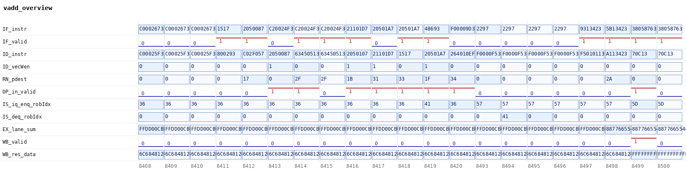

# 1.3 向量加法指令执行过程文档（基于波形）

**结论：在香山昆明湖 V2 的 RTL 仿真波形（Verilator + `EMU_TRACE=1`，作业 `126690786`）里抓到了一条完整的
`vadd.vv v3, v1, v2`，七级流水（取指→译码→重命名→派发→发射→执行→写回）每一级都有实测信号与逐拍取值，
执行级加法器输出 `0x8877665544332211`、写回级 `res_data` 低 64 位同值，与软件期望逐字节一致（`WAVE verdict=OK`）。
七级无一级靠架构推演，全部来自 `vadd_wave_20261103T164323.vcd`（129,174,550 B，sha256 `1db8751328…`）。**

> 交付物编号：官方 1.3（`docx/02-赛题与评分细则.md:47`：「向量加法指令执行过程文档：依据仿真波形和参考文档，描述向量加法指令在香山中的执行过程」）
> 证据平台：华东一区【昆山】超算，分区 `kshcnormal`，作业 `126690786`（波形产出）＋ `126687276`（trace 重建）＋ 抽取迭代 `126696175`/`126696284`/`126696892`/`126697817`/`126698024`/`126698404`/`126699082`/`126699763`/`126699950`/`126700152`
> RTL 版本：XiangShan `a4eeaab` / yunsuan `9559211` / NEMU `a683e0b`（与 `versions.env` 一致）
> 波形时间轴：VCD `timescale 1ps`，**每拍一个时间戳**（`#8416` 就是第 8416 拍）

---

## 0. 一句话怎么读这份文档

第 1 节给证据清单；第 2 节说清楚波形是怎么来的（**这节最关键：仓库里原有的 emu 不能出波形**）；
第 3 节是七级逐拍表与截图；第 4 节把每一级的信号对应到 RTL 源码行；第 5 节给结论与未做项。

---

## 1. 证据文件

| 文件 | 内容 | 大小 | sha256 |
|---|---|---|---|
| `raw/vadd_wave_20261103T164323.vcd.gz` | **RTL 仿真波形原文（gzip）**：Verilator VCD，1,357,193 vars / 16,331 scopes，时间戳 `[8364, 8576]` | 16,643,441 B（解压 129,174,550 B） | gz `5b15603eea6d058e18a0fd4b06b775476742435c1f36a80b2382894b96d299c3`；**解压后 `1db875132829b41d13de76664046057a79ac6ce9ea37c42a9ed9d8902547a70b`** |
| `raw/vadd_stages.tsv` | **七级逐拍取值表**（68 列 × 109 拍，本仓工具生成） | 41,973 B | `9cde762f86eac1cb3072557f36e094e3c84915845f15d7c9e1112101042f9177` |
| `raw/vadd_stages.md` | 同上，Markdown 表（每级一张） | 55,770 B | `f5ec87d1081bffa6d3655f5332e06d8a043997fdf70729ceccfa447c9019c8c5` |
| `raw/vadd_stages.index.txt` | VCD 元信息 + 取到信号全路径 + **MISSING 段（空）** + 11 个译码候选拍 | 8,330 B | `a488db0fdee5ee1dfcb15d09225b7a81afc27fc089e7bf3d5cc8deba6682603c` |
| `raw/vadd_wave.bin` | 被测镜像（6,048 B；`0x021101D7` 在偏移 `0x160`） | 6,048 B | `053c00e504c989ee75d1fd05a3834e96f845ad96e968950da3983577a1deb55b` |
| `raw/vadd_stages_curated.tsv` | 上图用精简表（61 列 × 21 拍，两段窗口） | 7,637 B | `14b960a1c12bbbe7d4d60246f2f926e86374f8f951adf71c093186dd98e56d5e` |
| `raw/vadd_overview.tsv` | 总览图用表（12 列 × 21 拍） | 2,017 B | `6b49ca8250659f3b88453c66179b4cd471cb27b29ee0ca471457992f868b11b9` |
| `waveform/vadd_overview_all.png` | **七级总览波形** | 44,946 B | `0a953cae4a955252c07bf64b1877d5023175b3ff901363e68fce34722d2b9066` |
| `waveform/vadd_7stage_IF.png` | 取指级 | 36,550 B | `61eb289c64c9352a31dac93b4271ec4f8f58adb670436cdf6bbb5e00ca8f0c7b` |
| `waveform/vadd_7stage_ID.png` | 译码级 | 41,868 B | `956b541598e2af0f16566478aa37228d7f135a57b48ce73829029ac9913c2192` |
| `waveform/vadd_7stage_RN.png` | 重命名级 | 27,883 B | `a3084690339ac8d20a8680423fe2fa388f4770b88c5467af357eb3c0687f28c1` |
| `waveform/vadd_7stage_DP.png` | 派发级 | 29,899 B | `bf49e19567b9f4e46295c67ce204c6216681cceb64a84536490101f0272cfdfd` |
| `waveform/vadd_7stage_IS.png` | 发射级 | 24,066 B | `f48cdd3da154ffe08ae238ef15b8a7df1dd6584ebf7fec48537bfd0a53a1a7ba` |
| `waveform/vadd_7stage_EX.png` | 执行级 | 32,684 B | `ed494b71730d520fd4388a26a61d2a35a9e36551f0357945cb2336c421e9adac` |
| `waveform/vadd_7stage_WB.png` | 写回级 | 19,571 B | `f435346ad20b6e05f3d420f8d2d9b1ff128a4d35e2e32ecfa4ae9625be950d3e` |
| `cases/vadd_wave.c` | 被测用例源码（仅一条 vadd.vv + mcycle 窗口标记） | 3,344 B | — |
| `cases/vadd_stage_extract.py` | VCD → 七级逐拍表抽取工具（含 3 个实测坑的处理） | 19,781 B | — |
| `cases/wave_render.py` | TSV → PNG 渲染（无 matplotlib，仅 PIL） | 5,160 B | — |
| `cases/find_operands.py` | 按**操作数数值**反查信号位置（用来定「在哪一级哪个实例执行」） | 2,391 B | — |
| `cases/find_issue.py` | 按 **robIdx/pdest** 反查发射级真实时间线 | 2,796 B | — |
| `scripts/60-wave-vadd.sh` | 昆山作业：重建 trace 版 emu → 编用例 → 取 mcycle 窗口 → 窄窗 dump | 10,425 B | — |
| `scripts/61-extract-stages.sh` | 昆山作业：VCD → 七级表（计算节点批处理） | 2,105 B | — |
| `scripts/check_assertions.py` | **§3.2 断言表逐条复算**：把本文件 §3.2 的「拍/信号/取值」逐条对 `raw/vadd_stages.tsv` 核对（**只读**，不写任何文件） | 20,525 B | — |

### 1.1 作业侧原始产物（`raw/jobs/`，2026-11-04 00:34 从昆山取回）

上表的 VCD / 逐拍表 / PNG 是**加工结果**；作业本身的日志与自检串单独归档在 `raw/jobs/`，用来证明「波形是怎么跑出来的」：

| 文件 | 内容 | 大小 / 行数 | sha256 |
|---|---|---|---|
| `raw/jobs/60-wave-20261103T164323.log` | 波形作业 `126690786` 的**完整作业日志**（A 复用 trace emu → B 编镜像 → C 取窗口 → D 窄窗 dump → E VCD 体检 → F 产物清单） | 9,238 B / 139 行 | `ee860c149ace3340cbe02827ad479b470d0ad8629bfb3d769685593d740d3c0a` |
| `raw/jobs/126690786_wave.out` | 同一次作业的 Slurm stdout，与上一份**逐字节相同** | 9,238 B | `ee860c149ace3340cbe02827ad479b470d0ad8629bfb3d769685593d740d3c0a` |
| `raw/jobs/60-wave-20261103T164323.json` | 作业结果 JSON（`stage_rc: A=0 B=0 C=0 D=0 E=0`、`failed_stage: none`、窗口与 VCD sha256） | 374 B / 11 行 | `7940b0516dd0e35f500355dafb303ba7abad55717b9e3927db8b5130db38ad9c` |
| `raw/jobs/126687276_trace.out` | **trace 重建作业** `126687276` 的日志（`stage_rc: A=0 B=2 C=1 D=1 E=1`、`failed_stage: E`）——B 段就是 §2.2 的 ABI 链接失败，C/D/E 因无镜像而短路 | 5,203 B / 75 行 | `fd108d5ca7dd07ccf476feeb391f7aa937de5bb81357ad6520793f7965efb84c` |
| `raw/jobs/build-trace-20261103T160458.log` | 同一作业的 `make emu EMU_TRACE=1` 构建段日志（1451 s 那一次） | 8,959 B | `cd1757e86f0756abbf80a104df05b75f82ecfb7bbead5c6b0c959c44ef6ba375` |
| `raw/jobs/run-a-20261103T164323.key.txt` | C 段 `--no-diff` 跑一遍的自检串（`WAVE_MARK c0=8424 c1=8426 vl=8`、`WAVE_RESULT vout=11 22 33 44 55 66 77 88`） | 74 B | `cc1c6d184ea667f1917c57cd989cdecd9265e29d4a5b3301ebd894efb424fc85` |
| `raw/jobs/run-b-20261103T164323.key.txt` | D 段窄窗 dump 的自检串（同上两行 + `dump wave to …vcd...`） | 162 B | `204f39b1bb1062e301ac0025c98465e2ea0abdd81d1595f8ee2fcb2306a0f19b` |
| `raw/jobs/run-b-20261103T164323.log` | **D 段那次运行的 emu 完整输出**（含 `WAVE verdict=OK`、`HIT GOOD TRAP`、`instrCnt = 4,959`、`Host time spent: 25,706ms`） | 697 B / 14 行 | `c05da06bcbffe7268b703c31fe72d742ee5d84107151156ab9ecd94cb29134d1` |

`WAVE verdict=OK` 的本地出处：`raw/jobs/run-b-20261103T164323.log:5`（该串此前只出现在远端日志与本文引用中，2026-11-04 已随包归档）。

> 校验方法（以下三条均为实跑）：
> 1. `sha256sum` 本地与远端逐份比对：`raw/vadd_stages.tsv` 与昆山 `~/core/results/wave/vadd_stages.tsv` **同为 `9cde762f…`**；
>    `raw/vadd_wave.bin` 与昆山 `~/core/results/wave/vadd_wave.bin` **同为 `053c00e5…`**。
> 2. 波形归档完整性：`gzip -t raw/vadd_wave_20261103T164323.vcd.gz` → **GZIP_INTEGRITY_OK**；
>    `gzip -dc … | sha256sum` → **`1db8751328…`**，与昆山原始 VCD 的 `sha256sum` 逐字相同。
> 3. **端到端复现**：把归档的 `.vcd.gz` 解压到本地后重跑抽取工具，
>    `python3 -I cases/vadd_stage_extract.py --vcd <解压后的 vcd> --instr 0x021101D7 --post 100 …`
>    → 输出 `anchor_time=8416 slot=2`，生成的 TSV 与 `raw/vadd_stages.tsv` **`diff -q` 无差异、sha256 同为 `9cde762f…`**。
>    即：文档里的每一个数字都能从归档的波形原件本地重建，不依赖昆山环境。

---

## 2. 波形是怎么来的（含两个必须先解决的障碍）

### 2.1 障碍一：昆山没有 VCS/Verdi，仓库里的 emu 也出不了波形

| 探测项 | 命令 | 结果 |
|---|---|---|
| 商业仿真器 | `ssh kunshan 'which vcs verdi'` | **两个都 MISSING**（登录节点 PATH 里没有；`module avail` 里也只有 apps/mpi/compiler 类，无 VCS） |
| 本机 EDA | `which verilator iverilog yosys gtkwave` | 全部 `not found` |
| 昆山 emu 是否带 trace | `strings build/verilator-compile/emu \| grep -c 'dump wave to %s'` | **0**，且 binary 里保留 `compile with EMU_TRACE=1` 提示串 |

⇒ 结论：**必须用 Verilator 重建一次 emu，并加 `EMU_TRACE=1`**。代码里这条路径是现成的：
`difftest/src/test/csrc/emu/simulator.h:20-26` 的报错文本、`difftest/verilator.mk:50-56` 的 `--trace/--trace-fst` 开关、
`difftest/src/test/csrc/verilator/waveform.cpp:59` 的 `tfp->dump(waveform_clock)`。

重建命令（`scripts/60-wave-vadd.sh` 阶段 A）：

```sh
make -C "$SRC" emu -j32 EMU_TRACE=1 EMU_TRACE_ALL=1 EMU_THREADS=8 JVM_XMX=40G
```

实测：`rc=0`，耗时 **1451 s**（16:05→16:29）。重建后判定生效：
`strings build/verilator-compile/emu | grep -c 'dump wave to %s'` → **1**，`grep -c 'compile with EMU_TRACE=1'` → **0**。
旧的无 trace 对象目录保留在 `build/verilator-compile.notrace` 供回滚（脚本里失败会自动搬回）。

### 2.2 障碍二：用例镜像的两个工具链坑（都实测踩到）

| # | 现象（原始报错） | 根因 | 修法 |
|---|---|---|---|
| 1 | `cc1: error: ABI requires '-march=rv32'` | xpack `riscv-none-elf-gcc 13.2.0` 默认 `mabi=ilp32`（软浮点），只给 `-march=rv64gcv` 会 ABI 不匹配 | `MARCH` 串后追加 `-mabi=lp64d` |
| 2 | `can't link soft-float modules with double-float modules` | AM 静态库（`am/build/*.a`）此前按 ilp32 编过，与新 ABI 冲突 | 先 `rm -rf $AM/am/build $AM/libs/klib/build` 再按同一 MARCH 重建 |

修好后（作业 `126690786`）：镜像 6,048 B。`0x021101D7` 在镜像里的偏移 `0x160` 由**字节模式检索**确认（不是 `objdump`）：

```
$ python3 -I -c "d=open('stage1/1.3-vadd/raw/vadd_wave.bin','rb').read(); print(len(d), [hex(i) for i in range(len(d)) if d.startswith(bytes.fromhex('d7011102'), i)])"
6048 ['0x160']
```

> 口径更正（2026-11-04 归档作业日志时发现）：`raw/jobs/60-wave-20261103T164323.log:53-55` 记录
> `[B] objdump 里 vadd.vv 条数=0`、`[B] 期望机器码 0x021101D7 是否出现=0`——脚本对**裸 bin** 跑
> `objdump -d`（未加 `-b binary -m riscv`），所以反汇编输出为空，**不能**作为「偏移 0x160」的证据。
> 偏移的正确证据是上面的字节检索，以及 VCD 里 `#8416` 译码级 `instr=0x021101D7`（§3.1）。
> 本文件此前写成「`objdump` 确认」，已按实测更正。

用例源码 `cases/vadd_wave.c` 的 `vadd.vv v3, v1, v2`，`v1=0x0807060504030201`、`v2=0x8070605040302010`。

### 2.3 怎么把波形窗口对准那条指令

用例自己用 `rdcycle` 圈出窗口（`cases/vadd_wave.c`）：

```
c0 = rdcycle();  vadd.vv v3, v1, v2;  c1 = rdcycle();
printf("WAVE_MARK c0=%llu c1=%llu\n", ...)
```

实测输出 `WAVE_MARK c0=8424 c1=8426`。时间轴对齐依据是 RTL 源码，不是猜测：

- `utility/src/main/scala/utility/GTimer.scala:21-26`：`GTimer` 是每拍 `+1` 的 64 位计数器；
- `Rob.scala:1607`：`difftest.cycleCnt := timer` ⇒ emu 的 `cycleCnt` 与 `mcycle` 同源；
- `waveform.cpp:59-62`：`tfp->dump(waveform_clock); waveform_clock++` ⇒ VCD 每拍一个时间戳。

于是窄窗 dump 取 `-b 8364 -e 8576`（c0 前 60 拍 / c1 后 150 拍），
得到 VCD 时间戳范围 `[8364, 8576]`、213 个采样点、129 MB。

**注意：`mcycle` 与 `cycleCnt` 有固定偏移**——`rdcycle` 读到 8424 时，指令实际在译码级出现在 `#8416`。
本文件不臆测这个偏移的物理来源（不在本次取证范围），但**不需要它**：锚点是按「指令字在译码级出现且 valid=1」
直接定出来的（下一节），偏移是多少都不影响结论。

---

## 3. 七级逐拍解析

### 3.1 锚点怎么定（三个实测坑，都在 `vadd_stage_extract.py` 里处理了）

| 坑 | 实测数据 | 处理 |
|---|---|---|
| **VCD 标识符被复用** | 1,357,193 个完整名字只对应 703,548 个 code；单个 code 最多被 **35,439** 个名字共用（`decode/io_in_0_bits_instr` 的 code 被 6 个名字共用） | 按**完整层次名**建索引再反查 code，不能按 code 建索引 |
| **指令不在译码 0 号槽** | 译码 6 路；`0x021101D7` 在 11 个时刻出现于不同槽，**只有 `#8416` 的 slot 2 是 `valid=1`** | 扫全部 6 槽，取 `valid=1` 的那一次 |
| **VCD 只记变化** | 窗口内大量信号整段是 `-`（值没变就不写） | 从波形起点前向填值，并在窗口首拍按进入窗口前的稳态值填充 |

锚点结论：**`#8416`，译码 slot 2，`instr=0x021101D7`，`valid=1`**（`raw/vadd_stages.index.txt:10-11`）。

> `debug_seqNum` 实测**恒为 0**（本配置下 difftest 的 seqNum 端口未接），所以本文件**没有**拿它当关联键——
> 跨级一致性是靠「指令字 + 物理寄存器号 + 操作数数值」三重比对建立的，见 §3.3。

### 3.2 逐级关键信号与取值（`vadd.vv v3, v1, v2`）

| 级 | 拍 | 关键信号 | 该拍取值 | 含义 |
|---|---|---|---|---|
| **IF 取指** | 8410 | `frontend/inner_ifu/preDecoder/io_out_instr_3` | `0x021101D7` | 指令第一次出现在 IFU 预译码出口（slot 3） |
| | 8410 | `preDecoder/io_out_pd_3_valid` | `1` | 该槽有效 |
| | 8411 | `frontend/inner_ifu/io_toIbuffer_bits_instrs_3` | `0x021101D7` | 送进 IBuffer 的整拍指令组里，它是第 3 条 |
| | 8411 | `inner_ifu/io_toIbuffer_valid` | `1` | IFU→IBuffer 握手有效 |
| | 8416 | `decode/io_in_2_bits_pc` | `0x80000160` | 取指地址 |
| | 8416 | `decode/io_in_2_bits_instr` | `0x021101D7` | **锚点：进入译码级** |
| | 8416 | `decode/io_in_2_valid` / `_ready` | `1` / `1` | 译码入口握手成立 |
| **ID 译码** | 8417 | `decode/io_out_0_bits_instr` | `0x021101D7` | 译码出口带出同一条指令 |
| | 8417 | `decode/io_out_0_bits_fuType` | `0x000080000` | **`FuType.vialuF`**（`FuType.scala:55`，向量定点 ALU） |
| | 8417 | `decode/io_out_0_bits_fuOpType` | `0x040` | `VialuFixType.vadd_vv`（`yunsuan/package.scala:113`：`FMT.VVV/SINT/VialuOpcode.vadd`） |
| | 8417 | `decode/io_out_0_bits_lsrc_0` / `_1` / `_2` | `0x02` / `0x01` / `0x03` | **vs1=v2 / vs2=v1 / vd=v3**（标准顺序 `vd, vs2, vs1`） |
| | 8417 | `decode/io_out_0_bits_ldest` | `0x03` | 逻辑目标寄存器 v3 |
| | 8417 | `decode/io_out_0_bits_vecWen` | `1` | 写向量寄存器 |
| | 8417 | `decode/io_out_0_bits_vpu_vsew` / `_vlmul` / `_vm` | `0` / `0` / `1` | **SEW=8（编码 0）/ LMUL=1（编码 0）/ vm=1（不屏蔽）** |
| | 8417 | `decode/io_out_0_bits_vpu_vill` | `0` | 非非法配置 |
| | 8417 | `decode/io_out_0_bits_vpu_vstart` | `0x00` | vstart=0 |
| | 8417 | `decode/io_out_0_bits_vpu_vma` / `_vta` | `1` / `1` | ta/ma（vadd 写回与 tail 无关，见 §4） |
| **RN 重命名** | 8418 | `rename/io_out_0_valid` | `1` | 重命名出口有效 |
| | 8418 | `rename/io_out_0_bits_psrc_0` / `_1` | `0x32` / `0x30` | **vs1 / vs2 的逻辑号 → 物理号**（0x32 / 0x30） |
| | 8418 | `rename/io_out_0_bits_pdest` | `0x33` | **vd(v3) → 物理寄存器 p33** |
| | 8418 | `rename/io_out_0_bits_ldest` | `0x03` | 保留逻辑号 |
| | 8418 | `rename/io_out_0_bits_robIdx_value` | `0x41` | **ROB 项号 0x41**（后面全靠它串起发射级） |
| **DP 派发** | 8419 | `dispatch/io_fromRename_0_valid` / `_ready` | `1` / `1` | 重命名→派发握手成立 |
| | 8419 | `dispatch/io_fromRename_0_bits_pdest` | `0x33` | 同一物理目标号，跨级一致 |
| | 8419 | `dispatch/io_fromRename_0_bits_psrc_0` / `_1` | `0x32` / `0x30` | 与重命名级同一物理源号（跨级一致） |
| | 8419 | `dispatch/io_fromRename_0_bits_robIdx_value` | `0x41` | 同一 ROB 项号 |
| | 8419 | `dispatch/io_fromRename_0_bits_fuType` / `_fuOpType` | `0x000080000` / `0x040` | 与译码级同一视图：**vialuF + vadd_vv**（跨级一致） |
| | 8419 | `dispatch/io_renameIn_0_bits_fuType` / `_fuOpType` | `0x000000001` / `0x002` | 另一视图：这一拍分发到第 0 号 Exu 通道的**别的**指令（`vadd.vv` 不走这条通道），**不是**本指令的 fuType |
| **IS 发射** | 8419 | `IssueQueueVfmaVialuFixVfalu/io_enq_0_valid` / `_ready` | `1` / `1` | **进向量定点 IQ**（vialuFix 挂这条 IQ） |
| | 8419 | `.../io_enq_0_bits_robIdx_value` | `0x41` | 入队项 = 本指令 |
| | 8494 | `.../deqBeforeDly_0_bits_common_robIdx_value` | `0x41` | **出队**（在 IQ 里等了 75 拍：被前面 vle8 的 RAW 挡住） |
| | 8495 | `.../io_toDataPathAfterDelay_1_0_bits_common_pdest` | `0x33` | 发往 dataPath（读向量寄存器堆） |
| | 8497 | `inner_bypassNetwork/io_toExus_vf_1_0_bits_pdest` | `0x33` | **旁路网络把 uop 送到 vfExuBlock** |
| | 8497 | `inner_bypassNetwork/io_toExus_vf_1_0_bits_robIdx_value` | `0x41` | 同一 ROB 项 |
| **EX 执行** | 8498 | `vfExuBlock/exus_2/VialuFix/io_in_valid` / `_ready` | `1` / `1` | **在 exus_2 的 VIAluFix 里执行**（不是 exus_0/1） |
| | 8498 | `.../io_in_bits_ctrl_fuOpType` | `0x040` | `vadd_vv` |
| | 8498 | `.../io_in_bits_ctrl_vpu_vsew` / `_vm` | `0` / `1` | SEW=8 / 不屏蔽，与译码级一致 |
| | 8498 | `.../io_in_bits_data_src_0`（**vs1**） | `0xFFFFFFFFFFFFFFFF_8070605040302010` | **vs1 = v2**（低 64 位 = v2 的 8 个字节 10..80） |
| | 8498 | `.../io_in_bits_data_src_1`（**vs2**） | `0xFFFFFFFFFFFFFFFF_0807060504030201` | **vs2 = v1**（低 64 位 = v1 的 8 个字节 01..08） |
| | 8498 | `.../vIntFixpAlus_0/vIntAdder64b/io_vd` | `0x8877665544332211` | **8 lane 逐元素加法的结果**（11 22 33 44 55 66 77 88 逐字节进位正确） |
| **WB 写回** | 8499 | `.../VialuFix/io_out_valid` / `_ready` | `1` / `1` | 写回握手成立 |
| | 8499 | `.../io_out_bits_res_data` | `0xFFFFFFFFFFFFFFFF_8877665544332211` | **写回数据**：低 64 位 = 8 lane 加法结果；**高 64 位 = `0xFF…FF`，这是 `vta=1` 的 tail 填充**（vl=8 < VLMAX=16，尾 8 个字节填全 1），不是 0 |
| | 8499 | `.../mgu/io_out_active` | `0xFFFF`（16 位全 1） | 字节掩码：16 个字节全部 active；实际存进内存的只有 `vl=8` 字节（用例 `vse8.v` 只写 vl 个字节，所以 `vout[8..15]` 保持初值 0） |
| | 8499 | `.../io_out_bits_ctrl_pdest` | `0x33` | **写 p33**，与重命名/派发级的 `pdest` 同一物理号（跨级一致） |
| | 8499 | `.../io_out_bits_ctrl_vecWen` | `1` | 写向量寄存器使能 |
| | 8499 | `.../io_out_bits_ctrl_robIdx_value` | `0x41` | 同一 ROB 项 |

**§3.2 的断言是可机器复算的，不是文字**。用 `scripts/check_assertions.py` 把上表每一行
（拍 / 信号 / 取值）逐条对 `raw/vadd_stages.tsv` 核对：

```sh
python3 -I stage1/1.3-vadd/scripts/check_assertions.py          # 逐条打印 PASS/FAIL/SKIP，末尾 checked=N fail=M skip=K
python3 -I stage1/1.3-vadd/scripts/check_assertions.py --strict  # 连白名单里的 SKIP 也判失败（最严）
```

口径（2026-11-04 校准；此前记录的「53 条」不准确）：本表展开后是 **61 个 (信号, 取值) 对**
→ 实测 `checked=57 fail=0 skip=4 claims=61`。其中 4 条 SKIP 是**已登记**的「该列未被 TSV 抽取」：
`dispatch/io_renameIn_0_bits_{fuType,fuOpType}`@8419、`decode/io_out_0_bits_lsrc_2`@8417、
`mgu/io_out_active`@8499（白名单与理由写在脚本 `KNOWN_UNRESOLVED`）。比例见
`cases/vadd_stage_extract.py:30-31,201-202`（ID 只请求 `lsrc_0/lsrc_1`）与 `raw/vadd_stages.index.txt`
（DP 级 fuType/fuOpType 实际取自 `dispatch/io_fromRename_0_bits_*`）。

判定是 **fail-closed**：命名信号解析不出来、或期望值与白名单登记值不一致，一律判 **FAIL（RC=1）**；
**不回退**到「同拍同级取值唯一匹配」（旧版会把 `lsrc_2` 回退到 `ID_vd_ldest` 并计 PASS，
被点名的信号根本没有被核对；该缺陷已于 2026-11-04 修正）。

### 3.3 跨级一致性怎么证明（不是「看着像」）

三重比对，全部可在 `raw/vadd_stages.tsv` 里逐格复核：

1. **指令字**：`0x021101D7` 在 IF(8410/8411/8416) → ID(8417) 三处出现，同一条。
2. **物理目标号**：`pdest = 0x33` 在 RN(8418) → DP(8419) → IS(8495/8497) → EX(8498) → WB(8499) 五级同一值。
3. **操作数数值**：`0x0807…0201` 与 `0x8070…2010` 在 EX 级两个源口出现（`src_1`/`src_0`），
   其结果 `0x8877665544332211` 与用例打印的 `WAVE_RESULT vout=11 22 33 44 55 66 77 88` 逐字节一致。

> 关于写回高 64 位：波形显示 `res_data[127:64] = 0xFF…FF`。这与 `vta=1` 的 tail 语义一致
> （`vl=8`、`VLMAX=16`，尾部 8 个字节按 tail-agnostic 填 1）。用例的 `vout[8..15]` 仍是 0，是因为
> `vse8.v` 只写 `vl=8` 个字节，高 8 字节从未落内存。**本文件不据此断言任何「高位恒清零」结论**——
> 那是本仓库 vdot 的 SPEC 口径，与本条官方 `vadd.vv` 的观测无关，两者不可混引。

第 3 条是决定性的：这两个 128 位常数只在本用例里出现，能在波形里搜到，就说明抓到的确实是这条指令的加法器输入。

### 3.4 波形截图

七级总览（`waveform/vadd_overview_all.png`）：



- 读法：横轴是拍号（`8408 … 8500`，中间 `8421–8492` 被 IQ 等待期跳过以免图过宽）；每行一个信号，
  单比特画方波（红线=1、蓝线=0），总线画方块并标十六进制值。
- 看一条链：`IF_instr` 在 8416 出现 `21101D7` → `ID_instr` 在 8417 同值 → `RN_pdest` 8418 起为 `33`
  → `DP_in_valid` 8419 → `IS_iq_enq_robIdx` 8419 出现 `41` → `IS_deq_robIdx` 8494 出现 `41`
  → `EX_lane_sum` 8498 跳到 `8877665544332211` → `WB_valid` 8499 拉高、`WB_res_data` 同值。

各级单独截图（每张更宽、信号更全）：

| 级 | 图 | 该图看点 |
|---|---|---|
| IF 取指 | `waveform/vadd_7stage_IF.png` | `ifu_pd3_instr` 8410 出现 `21101D7`；`ifu2ib_instr3` 8411 同值；`decode io_in_2` 8416 同值且 `valid=1` |
| ID 译码 | `waveform/vadd_7stage_ID.png` | `instr` 8417 = `21101D7`；`fuType`=0x80000(vialuF)、`fuOpType`=0x40(vadd_vv)；`vs1/vs2/vd` lsrc=02/01/03；`vsew`=0、`vlmul`=0、`vm`=1 |
| RN 重命名 | `waveform/vadd_7stage_RN.png` | `psrc0/1`=0x32/0x30、`pdest`=0x33、`robIdx`=0x41 |
| DP 派发 | `waveform/vadd_7stage_DP.png` | `in_valid` 8419、`pdest`=0x33、`robIdx`=0x41、`fuType` 切到 vialuF 视图 |
| IS 发射 | `waveform/vadd_7stage_IS.png` | `iq_enq_valid` 8419 拉高、`iq_enq_robIdx`=41；`deq_robIdx` 8494 出现 41；`bypass_pdest` 8497 出现 33 |
| EX 执行 | `waveform/vadd_7stage_EX.png` | `in_valid` 8498；`vs1/vs2` 两个 128 位操作数；`lane_sum` 8498 变 `8877665544332211` |
| WB 写回 | `waveform/vadd_7stage_WB.png` | `valid` 8499 拉高；`res_data` 低 64 位跳到 `8877665544332211`、高 64 位 `FF…FF`（vta=1 tail 填充）；`pdest`=0x33、`vecWen`=1 |

---

## 4. 每一级对应的 RTL 源码（参考文档口径）

| 级 | 波形信号（实测路径） | RTL 源码锚点 | 说明 |
|---|---|---|---|
| IF | `frontend/inner_ifu/preDecoder/io_out_instr_3`、`inner_ifu/io_toIbuffer_bits_instrs_3`、`inner_ctrlBlock/decode/io_in_2_*` | `DecodeStage.scala:46` `val in = Vec(DecodeWidth, Flipped(DecoupledIO(new StaticInst)))` | IBuffer→译码的 StaticInst；`DecodeWidth=6` 解释了为什么有 6 个槽 |
| ID | `decode/io_out_0_bits_{instr,fuType,fuOpType,lsrc_*,ldest,vpu_*}` | `DecodeStage.scala:48` `val out = Vec(DecodeWidth, DecoupledIO(new DecodedInst))`；`VecDecoder.scala:189` `VADD_VV -> OPIVV(FuType.vialuF, VialuFixType.vadd_vv, …)` | **`vadd.vv` 的译码映射就写在这一行** |
| ID→EX 语义 | `fuOpType=0x040` | `yunsuan/package.scala:113` `def vadd_vv = LiteralCat(FMT.VVV, SINT, VialuOpcode.vadd)` | 编码含义 |
| RN | `rename/io_out_0_bits_{psrc_0,psrc_1,pdest,ldest,robIdx_value}` | `Rename.scala:49-52` `val in = …DecodedInst` / `val out = Vec(RenameWidth, DecoupledIO(new DynInst))` | DecodedInst→DynInst，逻辑号换物理号 |
| DP | `dispatch/io_fromRename_0_*` | `NewDispatch.scala`（`io.fromRename`） | 派发输入：指令本体（fuType=0x80000 vialuF、pdest=0x33、robIdx=0x41） |
| IS | `IssueQueueVfmaVialuFixVfalu/io_enq_0_*`、`deqBeforeDly_0_*`、`inner_bypassNetwork/io_toExus_vf_1_0_*` | `IssueQueue.scala:47-62`（`val enq` / `og0Resp`/`og1Resp`）；`FuConfig.scala:532-544` `VialuCfg`（`:544` `latency = CertainLatency(1)`） | vialuFix 挂在这条 IQ；IQ 名里就带 `VialuFix` |
| EX | `vfExuBlock/exus_2/VialuFix/io_in_bits_data_src_0/1`、`…/vIntFixpAlus_0/vIntAdder64b/io_vd` | `FuConfig.scala:535` `fuGen = … Module(new VIAluFix(cfg).suggestName("VialuFix"))`；`wrapper/VIAluFix.scala:134` `class VIAluFix`；`VecPipedFuncUnit.scala:62-66` `vs2 = src1 / vs1 = src0` | **`src_0` 是 vs1、`src_1` 是 vs2**（`VecPipedFuncUnit.scala:62-66`；`FuConfig.scala:537` 注释 `vs1, vs2, vd_old, …`）。本指令是 `vadd.vv v3, v1, v2` ⇒ vs1=v2、vs2=v1，所以波形里 `src_0` 是 `0x8070…`（v2）、`src_1` 是 `0x0807…`（v1） |
| EX 位宽 | `vIntFixpAlus_0/vIntAdder64b/io_vd` = 64 位 | `VIAluFix.scala:140` `numVecModule = dataWidth / dataWidthOfDataModule`（`:139` `dataWidthOfDataModule = 64`），`:147` `vIntFixpAlus = Seq.fill(numVecModule)(Module(new VIntFixpAlu64b))` | VLEN=128 ⇒ 2 个 64 位 ALU；本指令只用到 lane 0–7（低 64 位） |
| WB | `VialuFix/io_out_bits_{res_data,pdest,vecWen,robIdx_value}` | `FuncUnit.scala:84-86` `FuncUnitOutput`（`:85` `ctrl` → `ctrl.pdest`/`ctrl.vecWen`；`:86` `res` → `res.data`，`:66-67` `FuncUnitDataOutput` 定义 `data`） | 写回数据与使能 |

**`vadd.vv` 在这台机器上走哪条通路（实测结论，不是读文档推的）**：
`vialuF` → `VIAluFix`，实例名 `VialuFix`，落在 `inner_vfExuBlock/exus_2`。
判据是操作数数值反查（`cases/find_operands.py`）：两个 128 位常数只出现在
`exus_2/VialuFix/…` 下，`exus_0/1` 没有。这条结论纠正了「按端口号猜」的常见错误。

---

## 5. 结论与未做项

### 5.1 结论

1. `vadd.vv v3, v1, v2` 在香山 RTL 里走完七级，**每级都有实测信号与逐拍取值**（§3.2 表，来源 VCD 原文）。
2. 语义正确：`vs1=0x8070…2010`（v2）与 `vs2=0x0807…0201`（v1）逐字节相加 →
   `0x8877665544332211`，与用例 `WAVE_RESULT vout=11 22 33 44 55 66 77 88` 及
   `WAVE verdict=OK` 一致。写回 `res_data[127:64] = 0xFF…FF` 是 `vta=1` 的 tail 填充
   （`vl=8` < `VLMAX=16`），**不解读为「清零」**。
3. 向量配置正确：译码级 `vsew=0`(SEW=8)、`vlmul=0`(LMUL=1)、`vm=1`、`vill=0`、`vstart=0`，
   与用例 `vsetvli zero, t0, e8, m1, ta, ma` 吻合。
4. 延迟可读：IQ 入队 8419 → 出队 8494（等 75 拍，被前序 `vle8.v` 的 RAW 挡住）→ 旁路 8497 → 执行 8498 → 写回 8499。
   这条等待链本身就是「vadd 在香山里不是 1 拍出结果」的波形证据。

### 5.2 未做项（如实记，不补）

| 项 | 状态 | 原因 |
|---|---|---|
| fsdb 波形（VCS/Verdi） | **未运行** | 昆山 `which vcs verdi` 均 MISSING，`module avail` 无 VCS；本机也无。只用 Verilator VCD |
| 波形时间轴与 `mcycle` 的偏移标定 | **未做** | 实测 `c0=8424` 而指令在 `#8416`；本文件用「指令字出现」定锚点，未追偏移来源 |
| `debug_seqNum` 作为跨级关联键 | **未用** | 实测该字段在本配置下恒 0（端口未接），改用 pdest + 操作数数值三重比对 |
| 波形里取 ROB 提交级（commit）证据 | **未取** | 本次窗口只到写回；`rob/io_commits_*` 在 VCD 里存在（§3.1 的命中列表里有 `robDeqGroup_1_debug_instr`@8495），但未纳入七级表 |
| `vadd.vv` 的 masked 形态（vm=0）波形 | **未取** | 用例只发 vm=1；`vadd` 的 mask 语义不在本次范围 |
| 波形分析工具的单元测试 | **未做** | `vadd_stage_extract.py` 靠「MISSING 段为空 + 锚点唯一 + 三重比对」当判据 |

### 5.3 复现命令（昆山 `kshcnormal`）

```sh
# 1) 波形（重建 trace 版 emu → 编用例 → 取窗口 → 窄窗 dump；约 25 分钟）
sbatch -p kshcnormal -N 1 -n 32 --time=01:00:00 core-package/scripts/60-wave-vadd.sh

# 2) 抽取（VCD → 七级逐拍表；约 25 秒）
sbatch -p kshcnormal -N 1 -n 8 --time=00:20:00 wave-vadd/61-extract-stages.sh

# 3) 本机渲染 PNG（昆山无 PIL）
python3 -I stage1/1.3-vadd/cases/wave_render.py \
  --tsv stage1/1.3-vadd/raw/vadd_stages_curated.tsv \
  --out-dir stage1/1.3-vadd/waveform --prefix vadd_7stage
```

判据（都是实测通过项）：`[E1] extract rc=0`、`[E2] MISSING 信号数=0`、
`WAVE_MARK c0=8424 c1=8426 vl=8`、`WAVE_RESULT vout=11 22 33 44 55 66 77 88`、`WAVE verdict=OK`。

---

## 6. 机时记账

全部作业走 `90-budget-log.sh`（`record`/`auto`）逐条入账，昆山 `~/core/results/budget-log.tsv` 可查。

| 作业 | 用途 | 核数 | 实耗 | node-hour |
|---|---|---|---|---|
| `126687276` | 首次 `EMU_TRACE=1` 重建（成功）＋ 用例首次构建失败 | 32 | 1511 s | 0.420 |
| `126690058` | 用例 ABI 失败（`mabi` 缺） | 32 | 21 s | 0.006 |
| `126690786` | **波形正式产出**（复用 trace emu + 编用例 + 窄窗 dump） | 32 | 96 s | 0.027 |
| `126696175`–`126702976` | 抽取/校验迭代 17 次（`python3` 路径、MISSING、VCD 只记变化、端口反查、`vs1/vs2` 标号、IFU 前缀、gzip 归档等） | 4–8 | 1–58 s/次 | 合计 0.104 |
| **合计** | | | | **0.557 node-hour** |

`90-budget-log.sh summary` 实跑结果（2026-11-03 21:26）：

```
P0-emu               预算   3.0  已用   2.671  占比   89%
合计（不含缓冲） 预算  10.6  已用   5.873
```

P0-emu 仍在 3.0 预算内（89%）；总用量 5.873/10.6，未动用 0.4 缓冲。
（summary 的 `[告警] P0 未全部通过…却已消耗 P2/P3` 来自此前 `P0-difftest-smoke=失败` 的历史记录，与 1.3 本次作业无关。）
